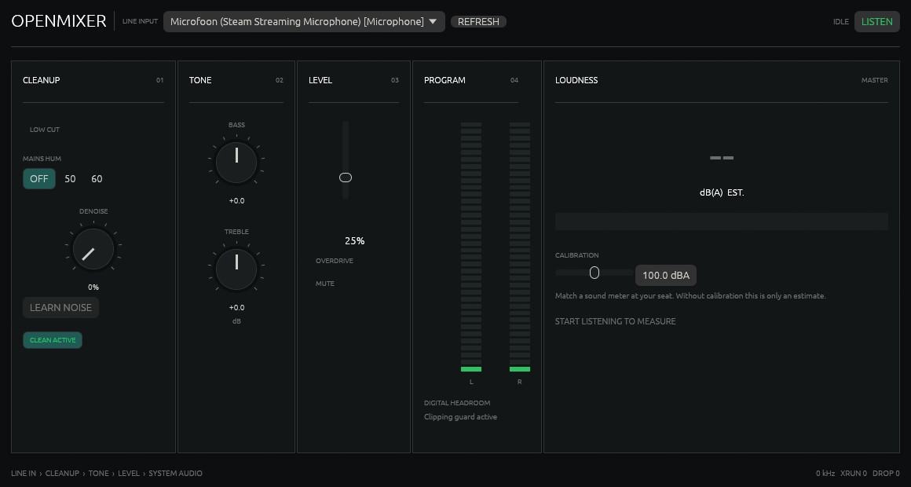

# OpenMixer

A small native desktop mixer for monitoring any line input without replacing or rerouting the rest of your system audio. Select a capture device, reduce steady electrical noise, shape the tone, and listen through the operating system's normal output. Typical sources include turntables with a built-in preamp, audio interfaces, cassette decks, instruments, and other line-level equipment.



## What it does

- Monitors only the input you select and follows the operating system's default playback device. It never changes that default.
- Remembers the selected input, cleanup, hum, denoise, tone, level, mute, overdrive, bypass, and calibration settings in `.openmixer/settings.ini` inside your user profile.
- Removes 50 Hz or 60 Hz mains hum and its first harmonics.
- Starts with cleanup off for a transparent signal. Optional two-second noise learning enables stereo-linked spectral reduction.
- Adds a 28 Hz rumble filter and ±12 dB bass/treble controls.
- Provides a 0–100% master fader. Overdrive extends it to 300% while peak protection remains active.
- Shows a stereo program meter plus a calibrated A-weighted loudness estimate with green, orange, and red risk zones.
- Updates itself from the latest stable GitHub release on Windows without changing your saved mixer settings.
- Runs as a native Rust application on Windows, macOS, and Linux through CPAL and egui.

The large readout is an **estimated dB(A)** value. A-weighting is applied in the audio engine, but a line input cannot know the gain of your amplifier, speaker sensitivity, listening distance, or the system volume after OpenMixer. The calibration control spans 20–120 dB(A); match it against a real sound meter at your listening position before treating the reading as meaningful. Green is below 85 dB(A), orange is 85–89 dB(A), and red is 90 dB(A) or higher. [NIOSH uses 85 dB(A) averaged over eight hours](https://www.cdc.gov/niosh/noise/about/noise.html) as its recommended exposure limit; loudness and exposure time both matter.

## Connect a line-level source

1. Set the source to line-level output. A turntable must use its built-in preamp in **LINE** mode or connect through a separate phono preamp; a raw `PHONO` signal is not line level.
2. Connect the source to a real stereo line input. Many laptop microphone jacks are mono and add gain/noise; a small USB audio interface with line inputs usually works better.
3. Disable Windows/macOS/Linux "Listen to this device" or other direct monitoring for the same input. OpenMixer should be the only monitoring path.
4. Choose your speakers or headphones as the operating system's normal default output.
5. Run OpenMixer, choose the line input, start at the default 25% level, and press **LISTEN**.
6. If you hear hum, select the local mains frequency: 50 Hz in most of Europe, including the Netherlands, or 60 Hz in North America. Leave it off when it does not help.
7. For steady hiss, pause the source and press **LEARN NOISE**. Increase denoise only as far as needed; spectral reduction can soften quiet musical detail.
8. To calibrate dB(A), play steady audio and adjust the calibration slider until OpenMixer matches a sound meter placed at your listening position.

If the noise exists before playback starts, also check the cable, PC input gain, and audio interface. Try keeping connected equipment on the same power strip, and test a different line input or shielded cable. Software can reduce steady hum and hiss, but it cannot repair clipping or remove the electrical cause of a ground loop.

## Install on Windows

Download the current release from the [OpenMixer releases page](https://github.com/JustKurayy/OpenMixer/releases/latest):

- **Setup EXE** — recommended. Installs OpenMixer for your Windows account, adds it to the Start menu, and provides a normal uninstaller. It does not require administrator access.
- **Portable ZIP** — contains `openmixer.exe`, this README, and the GPL license. Extract it anywhere writable and run the EXE directly.
- **Loose EXE** — the same standalone program without the accompanying files. This stable asset name is also what the in-app updater downloads.

OpenMixer checks GitHub quietly at startup. The **UPDATE** button stays hidden when the app is current and appears only when a newer stable release is ready; clicking it downloads the replacement, closes OpenMixer, updates its own EXE, and restarts. If the check fails, a **RETRY UPDATE** button appears. The installed and portable editions use the same updater, and `.openmixer/settings.ini` is left untouched. Automatic updating is currently available on Windows; macOS and Linux builds still require a manual update.

OpenMixer is not currently code-signed, so Windows SmartScreen may show an unknown-publisher warning on first launch. The release page includes SHA-256 digests for manual verification.

## Run from source

Install the current stable [Rust toolchain](https://rustup.rs/), then:

```console
cargo run --release
```

The optimized Windows binary is created at `target/release/openmixer.exe`. Release builds open only the graphical application and do not create a terminal window.

### Windows

Install Rust with the MSVC toolchain and the Visual Studio C++ Build Tools. OpenMixer uses the normal Windows audio backend and does not install a driver.

### macOS

Install Xcode Command Line Tools and Rust. macOS may request microphone permission because line inputs are classified as capture devices.

### Linux

Install Rust plus the native audio/window development packages. On Debian or Ubuntu:

```console
sudo apt install build-essential pkg-config libasound2-dev libx11-dev libxi-dev libxcursor-dev libxrandr-dev libxkbcommon-dev libwayland-dev
cargo run --release
```

## Signal path

```text
selected line input
  → 28 Hz low cut
  → 50/60 Hz harmonic notches
  → learned spectral reduction
  → bass and treble
  → smoothed master gain / mute
  → peak protection
  → operating system default output
```

OpenMixer currently requires the selected devices to share a 48 kHz or 44.1 kHz mode and supports `f32`, `i16`, and `u16` sample formats. It uses about 50 ms of safety buffering plus the spectral window; actual end-to-end latency depends on the hardware and operating system and has not been measured here. Device disconnection, buffer underruns, and overflows are shown in the interface.

The Windows build and UI were verified on the development machine. macOS and Linux use the same cross-platform audio code but still need hardware testing. Crackle restoration, recording, plugins, multiple buses, and virtual audio devices are intentionally outside this small release.

On the Windows development machine, the stripped release executable measured 8.0 MiB. With the interface open and audio stopped, one three-second sample measured 74.1 MiB working set and 2.6% of one CPU core. These are a single-machine idle snapshot, not cross-platform guarantees; active DSP usage still needs measurement with the actual line input.

## Development

```console
cargo fmt --check
cargo clippy --all-targets -- -D warnings
cargo test
cargo build --release
```

To recreate the Windows icon after editing `assets/openmixer.svg`, install Python, Pillow, and CairoSVG, then run `python scripts/build-icon.py`. To build all Windows release artifacts, install Inno Setup 6 and run:

```powershell
.\scripts\package-windows.ps1
```

Licensed under the [GNU General Public License v3](LICENSE).
